<!--
SPDX-FileCopyrightText: 2025 Digg - Agency for Digital Government

SPDX-License-Identifier: CC0-1.0
-->

# RAP-LP Open API Specification Guidelines Version 2.0.0

RAP-LP (REST API-profil Lint Processor) är ett verktyg som granskar en OpenAPI-specifikation mot den nationella REST API-profilen. Verktyget identifierar syntaxfel och avvikelser från riktlinjer, vilket gör det enklare att snabbt hitta och rätta till problem.

Verktyget analyserar OpenAPI-specifikationen och kontrollerar att API:et följer specifika designregler kopplade till REST API-profilen. Varje regel pekar på en specifik del av OpenAPI-specifikationen med ett JSON Path Plus-uttryck, och kontrollerar om värdena följer de fastställda reglerna. Om avvikelser hittas returneras ett eller flera felmeddelanden.

Utöver reglerna från REST API-profilen innehåller RAP-LP även ett regelområde benämnt **Förutsättningar**. Detta område omfattar tilläggsregler som inte ingår i profilen, men som baseras på etablerad god praxis för API-design. Reglerna i Förutsättningar kan hjälpa till att ytterligare höja kvaliteten på OpenAPI-specifikationen genom att identifiera förbättringsområden som inte täcks av den nationella profilen.

Denna version av RAP-LP är kompatibel med REST API-profil version 1.2.0, och varje ny version av verktyget kommer att ange vilken version av profilen den är avsedd att stödja.

## Regelstruktur

Detta dokument specificerar reglerna som verktyget tillämpar.

- Område: Aktuellt område i REST API-profilen för regeln
- Täckningsgrad: Hur många % av antalet regler i området som inkluderas och täcks av verktyget.
  - ID: Krav id i REST API-profilen för regeln.
  - Krav: Beskrivning av kravet enligt profilen.
  - Typ: Typ av krav (SKALL, SKALL INTE, BÖR, BÖR INTE, KAN)
  - JSON Path Plus-uttryck: Vilken del av OpenAPI-specifikationen regeln gäller
  - Förklaring: Hur regeln ska tolkas
  - Exempel: Illustration med text och bild

## Innehållsförteckning

1. [Område: Dokumentation](#område-dokumentation)
   - [ID: DOK.01](#id-dok01)
   - [ID: DOK.03](#id-dok03)
   - [ID: DOK.06](#id-dok06)
   - [ID: DOK.07](#id-dok07)
   - [ID: DOK.08](#id-dok08)
   - [ID: DOK.09](#id-dok09)
   - [ID: DOK.11](#id-dok11)
   - [ID: DOK.15](#id-dok15)
   - [ID: DOK.17](#id-dok17)
   - [ID: DOK.19](#id-dok19)
   - [ID: DOK.20](#id-dok20)
   - [ID: DOK.21](#id-dok21)
2. [Område: Datum- och tidsformat](#område-datum--och-tidsformat)
   - [ID: DOT.02](#id-dot02)
   - [ID: DOT.04](#id-dot04)
3. [Område: Resurser](#område-resurser)
   - [ID: RES.02](#id-res02)
   - [ID: RES.06](#id-res06)
4. [Område: URL Format och namngivning](#område-url-format-och-namngivning)
   - [ID: UFN.01](#id-ufn01)
   - [ID: UFN.02](#id-ufn02)
   - [ID: UFN.05](#id-ufn05)
   - [ID: UFN.07](#id-ufn07)
   - [ID: UFN.08](#id-ufn08)
   - [ID: UFN.09](#id-ufn09)
5. [Område: Mognad](#område-mognad)
   - [ID: MOG.01](#id-mog01)
   - [ID: MOG.02](#id-mog02)
6. [Område: API Message](#område-api-message)
   - [ID: AME.01](#id-ame01)
   - [ID: AME.02](#id-ame02)
   - [ID: AME.04](#id-ame04)
   - [ID: AME.05](#id-ame05)
   - [ID: AME.07](#id-ame07)
7. [Område: API Request](#område-api-request)
   - [ID: ARQ.01](#id-arq01)
   - [ID: ARQ.03](#id-arq03)
   - [ID: ARQ.05](#id-arq05)
8. [Område: Felhantering](#område-felhantering)
   - [ID: FEL.01](#id-fel01)
   - [ID: FEL.02](#id-fel02)
9. [Område: Versionhantering](#område-versionhantering)
   - [ID: VER.05](#id-ver05)
   - [ID: VER.06](#id-ver06)
10. [Område: Spårbarhet och korrelation](#område-spårbarhet-och-korrelation)
    - [ID: SPA.02](#id-spa02)
    - [ID: SPA.04](#id-spa04)
    - [ID: SPA.07](#id-spa07)
11. [Område: Filtrering, paginering och sökparametrar](#område-filtrering-paginering-och-sökparametrar)
    - [ID: FNS.01](#id-fns01)
    - [ID: FNS.03](#id-fns03)
    - [ID: FNS.05](#id-fns05)
    - [ID: FNS.06](#id-fns06)
    - [ID: FNS.07](#id-fns07)
    - [ID: FNS.08](#id-fns08)
    - [ID: FNS.09](#id-fns09)
12. [Område: Säkerhet](#område-säkerhet)
    - [ID: SAK.01](#id-sak01)
    - [ID: SAK.09](#id-sak09)
    - [ID: SAK.10](#id-sak10)
    - [ID: SAK.11](#id-sak11)
    - [ID: SAK.15](#id-sak15)
    - [ID: SAK.16](#id-sak16)
    - [ID: SAK.18](#id-sak18)
13. [Område: Förutsättningar](#område-förutsättningar)
    - [ID: FOR.02](#id-for02)

## Område: Dokumentation

**Täckningsgrad: 50%**

### ID: DOK.01

**Krav:** I regel BÖR dokumentationen och specifikationen för ett API finnas allmänt tillgänglig online.

**Typ:** BÖR

**JSON Path Plus-uttryck:**

```
$
```

**Förklaring:**

Regeln förutsätter att fältet `externalDocs` förekommer i specifikationen med följande underliggande struktur:

- description
- url.

**Exempel:**


---

### ID: DOK.03

**Krav:** Dokumentationen av ett API SKALL innehålla övergripande information om API:et.

**Typ:** SKALL

**JSON Path Plus-uttryck:**

```
$.info
$.info.contact
$.info.license
```

**Förklaring:**

Regeln förutsätter att det finns en förekomst av objektet `info` med underliggande struktur:

- Info
  - version
  - title
  - description
  - contact
    - name
    - url
    - email
  - license
    - name
    - url

**Exempel:**

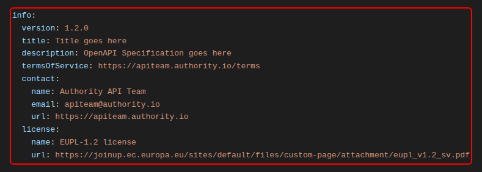

---

### ID: DOK.06

**Krav:** Dokumentationen BÖR finnas på både svenska och engelska.

**Typ:** BÖR

**JSON Path Plus-uttryck:**

```
$.info.description
```

**Förklaring:**
Regeln förutsätter att det finns en förekomst av objektet `info` med underliggande struktur:

- info
  - description

`description` förväntas dessutom innehålla dokumentation på både svenska och engelska. Detta görs i nuläget genom att försöka matcha enskilda ord mot de som finns i [ordlistorna.](src/rulesets/constants/CommonWords.ts)

**Exempel:**

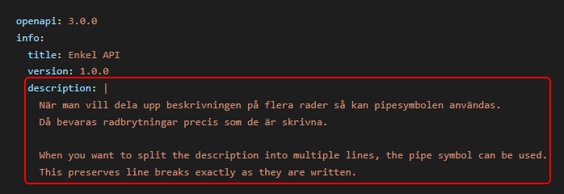

_Pipesymbolen kan med fördel användas när beskrivningen sträcker sig över flera rader eller stycken._

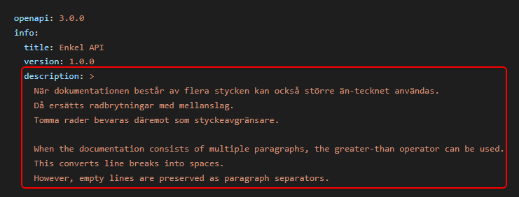

_Större än-tecknet kan också användas när beskrivningen sträcker sig över flera rader eller stycken._

---

### ID: DOK.07

**Krav:** Dokumentationen av ett API BÖR innehålla övergripande information om API:et.

**Typ:** BÖR

**JSON Path Plus-uttryck:**

```
$.info
```

**Förklaring:**
Regeln förutsätter att det finns en förekomst av objektet `info` med underliggande struktur:

- Info
  - description

**Exempel:**


---

### ID: DOK.08

**Krav:** Ett API:s servicenivå SKALL finnas tydligt beskriven i dokumentationen.

**Typ:** SKALL

**JSON Path Plus-uttryck:**

```
$
```

**Förklaring:**
Regeln förutsätter att det finns en förekomst av minst ett av objekten `info.termsOfService`, `info.x-sla` eller `externalDocs` med följande strukturer:

- info
  - termsOfService
  - x-sla
    - availability
    - responseTime
    - support

- externalDocs
  - description
  - url

`externalDocs.description` måste innehålla texten "service level agreement" eller "SLA", och `externalDocs.url` måste vara en giltig URL.

**Exempel:**

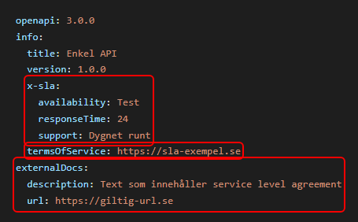

_Ett av objekten räcker för att uppfylla regeln._

---

### ID: DOK.09

**Krav:** Kända problem och begränsningar SKALL finnas tydlig beskrivna i dokumentationen.

**Typ:** SKALL

**JSON Path Plus-uttryck:**

```
$
```

**Förklaring:**
Regeln förutsätter att det finns en förekomst av något av objekten `info.description` och `externalDocs.description`, och att de innehåller någon av strängarna "limit", "begränsning" eller "problem". Alternativt så räcker det om det finns en förekomst av `info.x-limitations`.

**Exempel:**

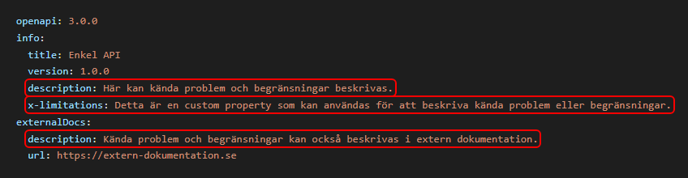

_Ett av objekten räcker för att uppfylla regeln, men "limit", "begränsning" eller "problem" behöver nämnas i `description`-fälten för att de ska räknas._

---

### ID: DOK.11

**Krav:** Avsikten och beteendet hos API:et SKALL beskrivas så utförligt och tydligt som möjligt.

**Typ:** SKALL

**JSON Path Plus-uttryck:**

```
$.info
```

**Förklaring:**
Regeln förutsätter att det finns en förekomst av fältet `description` under objektet `info`.
Beskrivningen måste finnas och får endast vara en icke-tom textsträng som inte enbart består av blanksteg.

**Exempel:**

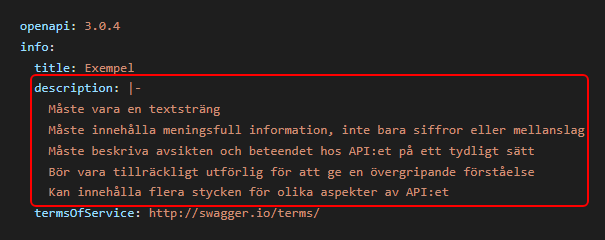

_Exemplet ovan är giltigt då description finns, och innehåller en textsträng som inte enbart består av blanksteg._

---

### ID: DOK.15

**Krav:** I dokumentationen av API:et SKALL exempel på API:ets fråga (en:request) och svar (en:reply) finnas i sin helhet.

**Typ:** SKALL

**JSON Path Plus-uttryck:**

```
$.paths[*][*].responses[*].content.application/json

$.paths[*][?(@ != "get")].requestBody.content.application/json
```

**Förklaring:**
Regeln förutsätter att det finns en förekomst av fältet `examples` i specifikationen under de angivna nivåerna.

Den förutsätter också att det finns en förekomst av fältet `examples` i specifikationen på de angivna nivåerna under fältet `requestBody`.

**Exempel:**

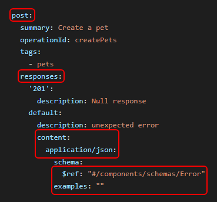

_I det första exemplet används ett POST-response för att illustrera hur regeln undersöker om fältet `examples` förekommer._

_Om en schemadefinition refereras med nyckelordet `$ref`, ignoreras övriga fält på den aktuella nivån. Det innebär att om fältet `examples` förekommer i den refererade schemadefinitionen, har det företräde framför ett eventuellt `examples`-fält som anges inline._

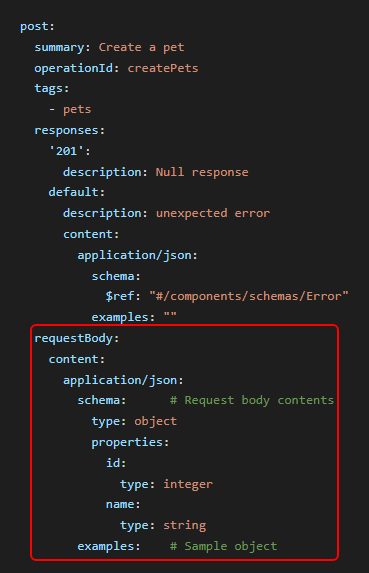

_I det andra exemplet illustrerar vi hur en korrekt implementation av regeln hanterar en POST-request. På samma sätt som det första exemplet ignoreras övriga fält på den aktuella nivån om schemadefinitionen refereras med nyckelordet `$ref`._

---

### ID: DOK.17

**Krav:** API-specifikation BÖR dokumenteras med den senaste versionen av OpenAPI Specification.

**Typ:** BÖR

**JSON Path Plus-uttryck:**

```
$
```

**Förklaring:**

Regeln förutsätter att OpenAPI-specifikation dokumenteras med den senaste major versionen av OpenAPI. Detta för att få full täckning av de implementerade reglerna. Regeln förutsätter vidare att man använder sig av fältet openapi för att beskriva värdet.

**Exempel:**

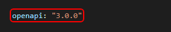

_Detta exempel visar ett godkänt värde för versionsfältet i en OpenAPI-specifikation, i enlighet med den aktuella regeln._

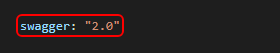

_Detta exempel illustrerar ett icke godkänt värde för OpenAPI-specifikation versionsfält, där swagger: "2.0" används i stället för det föreskrivna fältet openapi._

---

### ID: DOK.19

**Krav:** Ett API:s resurser och de möjliga operationer som kan utföras på resursen SKALL beskrivas så utförligt och tydligt som möjligt.

**Typ:** SKALL

**JSON Path Plus-uttryck:**

```
$.paths[*][*]
```

**Förklaring:**
Regeln förutsätter att objektet `paths` förekommer. Den kontrollerar att fälten `description` och `summary` finns för varje GET-, POST-, PUT-, PATCH- eller DELETE-operation.

**Exempel:**

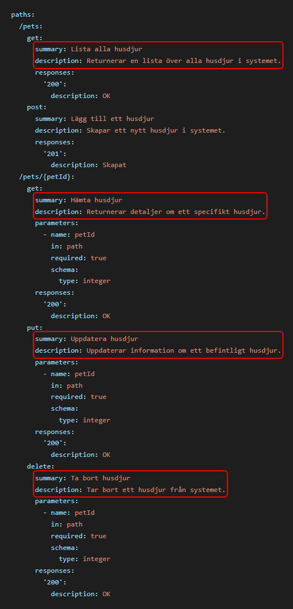

_I exemplet ovan illustreras regeln med flera operationer, där DOK.19 kontrollerar att fälten description och summary är ifyllda._

---

### ID: DOK.20

**Krav:** Förväntade returkoder och felkoder SKALL vara fullständigt dokumenterade.

**Typ:** SKALL

**JSON Path Plus-uttryck:**

```
$.paths[*][*].responses[*]

```

**Förklaring:**
Regeln förutsätter att det finns en förekomst av objektet `Paths`. Regeln undersöker vidare om det under fältet `responses` finns förekomster av fältet `description` i varje förekomst av en GET, POST, PUT, PATCH eller en DELETE operation.

**Exempel:**

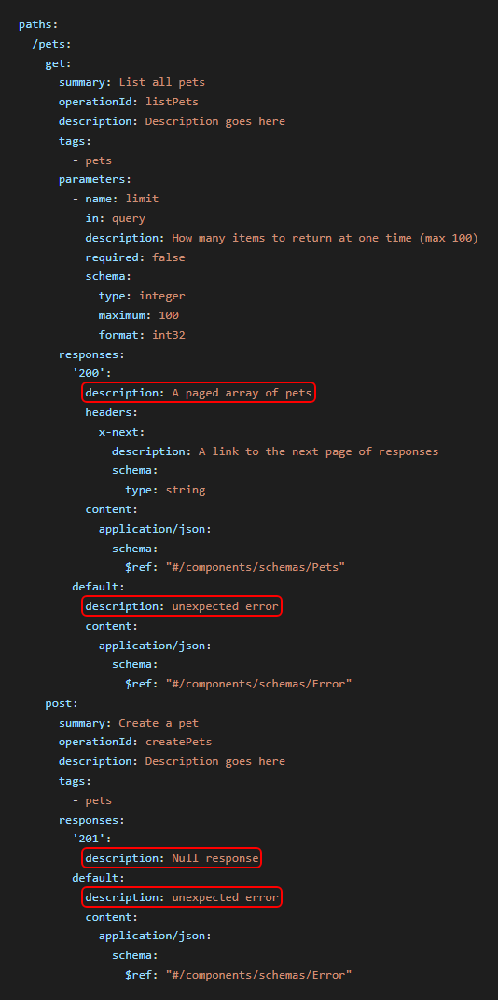

_Exemplet illustrerar hur regeln tillämpas på både GET- och POST-operationer. Regeln kräver att varje svar under responses innehåller fältet description. Detta gäller även standardsvaret default, som också omfattas av regelvalideringen._

---

### ID: DOK.21

**Krav:** Krav på autentisering SKALL anges i specifikationen.

**Typ:** SKALL

**JSON Path Plus-uttryck:**

```
$
```

**Förklaring:**
Regeln förutsätter att det finns minst en förekomst av objektet `security`, antingen på rot- eller operationsnivå.

**Exempel:**

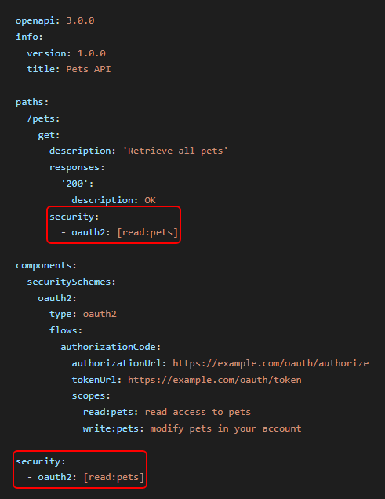

_Security-objektet kan existera på antingen rot- eller operationsnivå, eller båda._

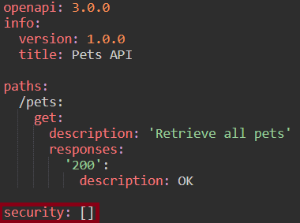

_Om säkerhet saknas så bör det signaleras genom att tilldela security-objektet en tom array._

---

## Område: Datum- och tidsformat

**Täckningsgrad: 50%**

### ID: DOT.02

**Krav:** Datum och tid SKALL (DOT.02) anges enligt [RFC 3339](https://datatracker.ietf.org/doc/html/rfc3339) som bygger på ISO-8601.

**Typ:** SKALL

**Förklaring:**
Regeln förutsätter att det finns datum- eller tidsvärden angivna som exempel i OpenAPI-specifikationen. Exempelvärdet kontrolleras mot RFC 3339-formatet.

Datum anges enligt `YYYY-MM-DD` och tid enligt formatet `hh:mm:ss`, där delar av en sekund är valfritt.

Datum och tid kombineras enligt följande format:
`YYYY-MM-DDThh:mm:ss:ff` där `T` separerar datum från tid och `ff` anger delar av en sekund.

**Exempel:**

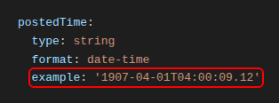

_Exemplet ovan föreställer ett datum- och tidsvärde som anges enligt RFC 3339. Exempelvärdet `1907-04-01T04:00:09.12` innehåller år, månad, dag, timme, minut, sekund samt delar av en sekund._

<!-- ### ID: DOT.01

**Krav:** Datum och tid SKALL hanteras enligt följande, använd alltid RFC 3339 för datum och tid, acceptera alla tidszoner i API:er returnera datum och tid i UTC och använd inte tidsdelen om du inte behöver den.

**Typ:** SKALL

**JSON Path Plus-uttryck:**

```
$.responses.content.application/json.schema.properties
```

**Förklaring:**
Regeln förutsätter att det finns förekomster av fält i retursvar och som beskrivs som datumfält och har formatet `date-time` under fältet `responses`. Formatet `date-time` accepteras även formatet `Z` för Zulu Time.

**Exempel:**

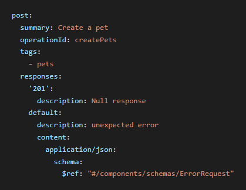 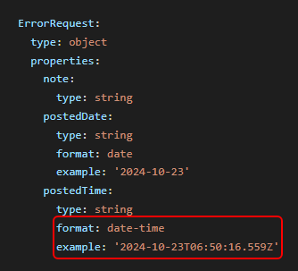

I exemplet ovan, så exemplifieras regeln med en POST operation, där regeln förutsätter att det finns en förekomst av fältet examples under i detta fall attributet ”postedTime ”. Ifall man refererar en schema definition med hjälp av nyckelordet $ref, så ignoreras övriga element på aktuell nivå. Detta innebär att om det finns ett exempel fält på schema nivå så ”overridar” den ett ev. ”inline” exempelfält.

--- -->

### ID: DOT.04

**Krav:** Datum och tid SKALL hanteras enligt följande, använd alltid RFC 3339 för datum och tid, acceptera alla tidszoner i API:er returnera datum och tid i UTC och använd inte tidsdelen om du inte behöver den.

**Typ:** SKALL

**JSON Path Plus-uttryck:**

```
$.components.schemas
```

**Förklaring:**

Regeln söker efter förekomster av fält som beskrivs som datumfält och har formatet `date` och/eller `date-time`. För formatet `date-time` accepteras också formatet `Z` för Zulu Time. Enligt RFC 3339 kan tidszoner anges på olika sätt, vilket innebär hantering av både UTC (som slutar på Z) samt offset (±hh:mm).

**Exempel:**


_Exemplet illustrerar hur regeln kontrollerar förekomsten av fältet examples under attributen postedDate och postedTime, oavsett typ av operation. Om en schemadefinition refereras med nyckelordet $ref, ignoreras övriga fält på den aktuella nivån. Det innebär att ett examples-fält i den refererade schemadefinitionen har företräde framför ett eventuellt examples-fält som anges inline._

---

## Område: Resurser

**Täckningsgrad: 33%**

### ID: RES.02

**Krav:** Primärnycklar eller personligt identifierbar information (personnummer, etc.) BÖR INTE exponeras.

**Typ:** BÖR

**JSON Path Plus-uttryck:**

```
$.paths[*].*.parameters[*]
```

**Förklaring:**
Regeln kontrollerar att parametrar av typerna query och path inte använder följande namn:

- pnr
- personalidentitynumber
- personnummer
- personnr
- ssn
- socialsecuritynumber

**Exempel:**

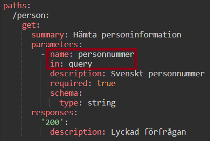

_Exemplet ovan är giltigt då namnet på parametern inte är ett av ovanstående._

---

### ID: RES.06

**Krav:** Resurser SKALL följa den namnsättningskonvention som beskrivs för URL:er, det vill säga att resurser anges med gemener, använder endast alfanumeriska tecken och bindestreck för att separera eventuella ord.

**Typ:** SKALL

**JSON Path Plus-uttryck:**

```
$.paths[*]~
```

**Förklaring:**
Regeln kontrollerar att resurser anges i alfanumeriska tecken (ej versaler), och bindestreck för att separera eventuella ord. Undantag görs för path-parametrar som skrivs inom måsvingar ({}), då dessa ofta skrivs i camelCase.

**Exempel:**

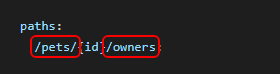

_Varje resurs och underresurs (separerade med /) kontrolleras enskilt._

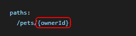

_Path-parametrar undantas från regeln._

---

## Område: URL Format och namngivning

**Täckningsgrad: 54%**

### ID: UFN.01

**Krav:** En URL för ett API BÖR följa namnstandarden:
`{protokoll}://{domännamn}/{api}/{version}/{resurs}/{identifierare}?{parametrar}`

**Typ:** BÖR

**JSON Path Plus-uttryck:**

```
$.servers[*]
```

**Förklaring:**
Regeln söker efter 1-n förekomster av Serverobjekt och kontrollerar att fältet `url` följer namnstandarden fram till versionen av API:et:\
**{protokoll}://{domännamn}/{api}/{version}**

Versionen anges som en major-version, exempelvis `v1`, `v2` eller `v10`.

Om `url` innehåller Server Variables, exempelvis `{environment}` eller `{version}`, så gäller även följande:

- Varje variabel som används i `url` SKALL finnas under `variables` i samma Serverobjekt.
- Varje sådan variabel SKALL ha ett `default`-värde.
- Variablerna ersätts med sina `default`-värden och den resulterande URL:en kontrolleras mot namnstandarden. En variabel på versionens plats SKALL därmed ha ett `default`-värde som följer formatet `v[0-9]+`.

Variabler kan förekomma i alla delar av URL:en. Variabler som definieras under `variables` men inte används i `url` ignoreras.

**Exempel:**

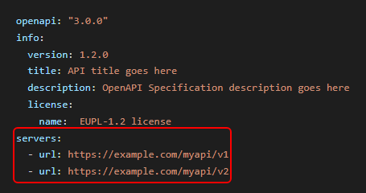

I exemplet ovan, så följer båda url:erna namnstandarden med api-namnet `myapi` och major-versionerna `v1` respektive `v2`.

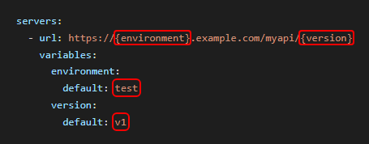

I exemplet ovan, så används Server Variables i `url`. Båda variablerna finns under `variables` med ett `default`-värde, och `version` har ett `default`-värde som följer formatet för major-version.

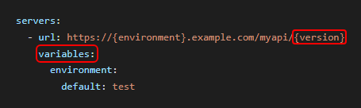

I exemplet ovan, så används `{version}` i `url` men variabeln saknas under `variables`, vilket bryter mot regeln.

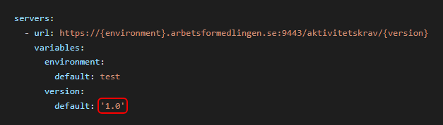

I exemplet ovan, så följer inte `default`-värdet för `version` formatet för major-version, vilket bryter mot regeln.

---

### ID: UFN.02

**Krav:** Alla API:er SKALL exponeras via HTTPS på port 443.

**Typ:** SKALL

**JSON Path Plus-uttryck:**

```
$.servers.[url]
```

**Förklaring:**
Regeln kontrollerar fältet `url` under varje Server Object och verifierar att API exponeras via HTTPS.

Om en port anges explicit i URL SKALL den vara 443. Om ingen port anges används standardporten för HTTPS, vilket är port 443.

Kontrollen av protokollet är inte case-sensitive. Validering av tillåtna tecken och casing hanteras av UFN.07.

**Exempel:**

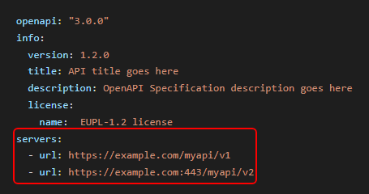

I exemplet ovan, så exemplifieras regeln med att den första url:en inte exponerar en speciell port och i den url:en så är då port 443 default, medans den andra url:en definierar en port 443.

---

### ID: UFN.05

**Krav:** En URL BÖR INTE vara längre än 2048 tecken.

**Typ:** BÖR

**JSON Path Plus-uttryck:**

```
$.servers[*].url
$.paths
```

**Förklaring:**
Regeln kontrollerar att inte längden på URL:en definierade av fälten beskrivna i ovan JSON Path Plus-uttryck överstiger 2048 tecken. Under objektet `servers`, så inkluderas fältet `url` och under objektet `paths`, så inkluderas och kontrolleras varje ingående del i pathen.

**Exempel:**


_I exemplet ovan, så utgör fältet url de båda url:ena man ser under serverobjektet, föremål för kontroll._

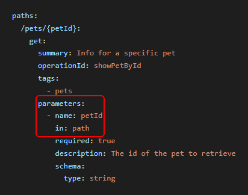

_I exemplet ovan, så utgör paths tillsammans med parameters sektionen föremål för kontroll. Här exemplifieras det med en parameter av typen path._

---

### ID: UFN.07

**Krav:** URL:n SKALL använda dessa tecknen a-z, 0-9, "-", "." samt "~", se vidare i RFC 3986.

**Typ:** SKALL

**JSON Path Plus-uttryck:**

```
$.
```

**Förklaring:**
Regeln förutsätter att de giltiga tecken som specificeras i kravet förekommer i de fält som bygger upp URL:n. Detta görs genom att kontrollera de tecken som återfinns under objektet `servers` i fältet `url`, samt under objektet `paths`.

**Exempel:**

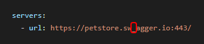

_I exemplet ovan, så utgör fältet url under serverobjektet, samt objektet paths föremål för kontroll._

---

### ID: UFN.08

**Krav:** Endast bindestreck '-' SKALL användas för att separera ord för att öka läsbarheten samt förenkla för sökmotorer att indexera varje ord för sig.

**Typ:** SKALL

**JSON Path Plus-uttryck:**

```
$.paths[*]~
```

**Förklaring:**
Regeln kontrollerar att endast bindestreck ’-’ används för att separera ord i den del av URL:n som byggs upp av path objektet.

**Exempel:**

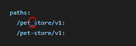

_I exemplet ovan, så utgör fältet url under serverobjektet, samt objektet paths med underliggande konstruktion av parameter föremål för kontroll._

---

### ID: UFN.09

**Krav:** Blanksteg ' ' och understreck '\_' SKALL INTE användas i URL:er med undantag av parameter-delen.

**Typ:** SKALL

**JSON Path Plus-uttryck:**

```
$.servers.[url]
$.paths[*]~
$.paths.*.*.parameters[?(@.in=='path')].name

```

**Förklaring:**
Regeln verifierar att blanksteg ' ' och understreck '\_' inte används i URL:erna. Regeln kontrollerar alla ingående delar av URL:en som definieras i serverobjektet under fältet `url`, de delar av URL:en som byggs upp i `path` objektet, samt de delar av URL:en som utgör parametrar av typen `path`, med undantag för parameterdelen som utgörs av typen `query`.

**Exempel:**


_I exemplet ovan, så utgör fältet `url` under serverobjektet, samt objektet `paths` med underliggande konstruktion av parameter av typen ”path” föremål för kontroll._

---

## Område: Mognad

**Täckningsgrad: 67%**

### ID: MOG.01

**Krav:** Alla API:er SKALL designas för att uppnå nivå 2 enligt Richardson Maturity Model.

**Typ:** SKALL

**JSON Path Plus-uttryck:**

```
$.paths
```

**Förklaring:**
Regeln kontrollerar att API:et uppfyller grundkraven för nivå 2 enligt Richardson Maturity Model:

- minst två normaliserade resurser är definierade (`/pets` och `/pets/{petId}` räknas som en resurs)
- minst två distinkta HTTP-metoder (GET, POST, PUT, DELETE eller PATCH) används i API:et
- minst en av metoderna GET, POST, PUT, DELETE eller PATCH finns definierad per resurs

**Exempel:**

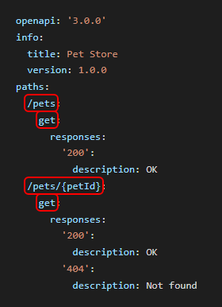

_Exemplet är giltigt: `/pets` och `/orders` är två normaliserade resurser med varsin distinkt REST-metod (GET och POST)._

---

### ID: MOG.02

**Krav:** Alla API:er BÖR designas för att uppnå nivå 3 enligt Richardson Maturity Model.

**Typ:** BÖR

**JSON Path Plus-uttryck:**

```
$.paths
```

**Förklaring:**
Regeln kontrollerar att API:et uppfyller samma grundkrav som MOG.01 (minst två normaliserade resurser, minst två distinkta HTTP-metoder, minst en giltig REST-metod per resurs) samt att minst ett svar i API:et innehåller en HATEOAS-indikator. Följande HATEOAS-indikatorer känns igen:

- `application/hal+json` används som mediatyp i ett svar
- Ett OpenAPI `links`-objekt är definierat i ett svar
- En `_links`-egenskap förekommer i ett svarsschema (HAL-format)
- Ett svarsschema innehåller ett länkobjekt med egenskaperna `href` och `rel`
- Ett svarsschema innehåller ett länkobjekt med egenskaperna `href` och `method`

Länkobjekten ovan kan förekomma direkt i schemat eller nästlat, exempelvis som `items` i en array av länkar.

**Exempel:**

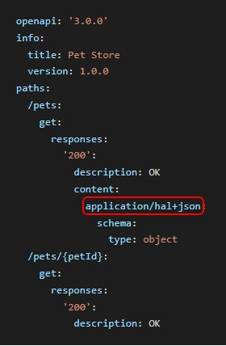

_Exemplet är giltigt: det uppfyller grundkraven för nivå 2 (två normaliserade resurser, distinkta metoder) samt innehåller `application/hal+json` som HATEOAS-indikator i `/pets` GET-svaret._

---

## Område: API Message

**Täckningsgrad: 71%**

### ID: AME.01

**Krav:** Datamodellen för en representation BÖR (AME.01) beskrivas med JSON enligt senaste versionen, RFC 8259.

**Typ:** BÖR

**JSON Path Plus-uttryck:**

```
$.paths[*][*].responses[?(@property < 400)].content
$.paths.*.*.requestBody.content
```

**Förklaring:**

Regeln förutsätter att svaren för de datastrukturer/modeller som används under `path` objektet, där http svarskoden är mindre än 400, beskrivs med `application/json`. Regeln kontrollerar också att de datastrukturer/modeller som används under `requestBody` objektet.

**Exempel:**

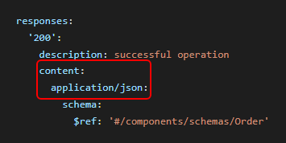

_Exemplet ovan illustrerar ett OK svar på en operation, där media typen under `content` objektet bör vara `application/json` enligt regeln._

---

### ID: AME.02

**Krav:** Det BÖR förutsättas att alla request headers som standard använder 'Accept' med värde 'application/json'.

**Typ:** BÖR

**JSON Path Plus-uttryck:**

```
$.paths.*.*.requestBody.content
```

**Förklaring:**
Regeln förutsätter också att de datastrukturer/modeller som används under `requestBody` objektet beskrivs med `application/json`.

**Exempel:**


_I exemplet ovan, så exemplifieras regeln med ett OK svar på en operation, där media typen under `content` objektet bör vara `application/json`._

---

### ID: AME.04

**Krav:** För fältnamn i request och response body BÖR camelCase eller snake_case notation användas.

**Typ:** BÖR

**JSON Path Plus-uttryck:**

```
$.components.schemas.properties[*]~
```

**Förklaring:**
Regeln förutsätter att den namnsättning som används för egenskaper beskrivna i request/responsebodyn beskrivs med camelCase eller snake_case notation, men standardiserade hypermediafält enligt HAL undantas.

**Exempel:**

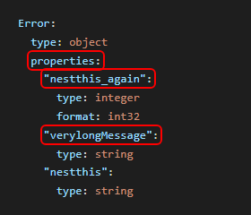

_Exemplet illustrerar hur regeln kontrollerar namngivningen av egenskaper i schemadefinitionen. Fältnamnen bör följa antingen camelCase eller snake_case, med undantag för standardiserade hypermediafält enligt HAL._

---

### ID: AME.05

**Krav:** Inom ett API SKALL namnsättningen vara konsekvent, dvs blanda inte camelCase och snake_case.

**Typ:** SKALL

**JSON Path Plus-uttryck:**

```
$.components.schemas.properties[*]~
```

**Förklaring:**
Regeln förutsätter att den namnsättning som används för egenskaper beskrivna under `components.schemas` är konsekvent. Antingen så ska camelCase eller snake_case notation användas.

**Exempel:**

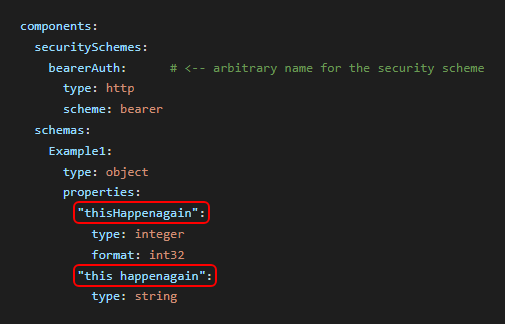

_Exemplet illustrerar ett icke godkänt fall där egenskaperna i API schemadefinitioner använder olika namngivningskonventioner. Både camelCase och snake_case förekommer, vilket strider mot regelns krav på en konsekvent namnsättning inom API._

---

### ID: AME.07

**Krav:** Fältnamn BÖR använda tecken som är alfanumeriska.

**Typ:** BÖR

**JSON Path Plus-uttryck:**

```
$.components.schemas.properties[*]~
```

**Förklaring:**
Regeln förutsätter att den namnsättning som används för egenskaper beskrivna under `components.schemas` är alfanumeriska. Regeln tillåter också i detta kontext det specifika tecknet ”\_” eftersom namnsättningskonventioner för egenskaper tillåts innehålla detta tecken. För mer information se regel AME.05

**Exempel:**

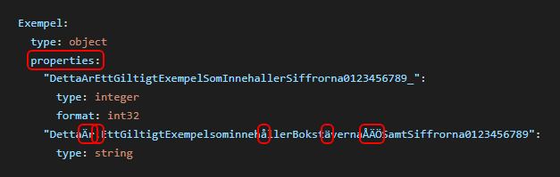

_Exemplet illustrerar ett giltigt och ett icke giltigt fältnamn i en schemadefinition. Det första fältnamnet uppfyller regelns krav på alfanumeriska tecken, medan det andra innehåller tecken som inte är tillåtna enligt regeln. Underscore (_) är tillåtet som avskiljare i fältnamn.\_

---

## Område: API Request

**Täckningsgrad: 60%**

### ID: ARQ.01

**Krav:** Ett request BÖR skickas i UTF-8.

**Typ:** BÖR

**JSON Path Plus-uttryck:**

```
$.paths[*][*].requestBody.content
```

**Förklaring:**
Regeln förutsätter att de datastrukturer/modeller som används under `requestBody` objektet skickas i UTF-8.

**Exempel:**

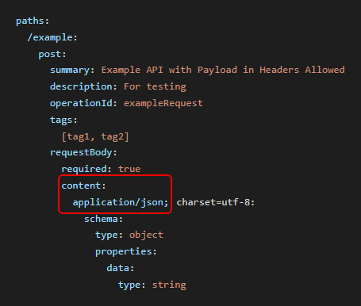

_I exemplet ovan, så exemplifieras regeln med en kontroll av att media typen under `content` objektet bör vara `application/json`. I exemplet ovan är charset specificerat, men hade kunnat utelämnas då default charset för media typen `application/json` är UTF-8._

---

### ID: ARQ.03

**Krav:** Alla API:er BÖR supportera följande request headers: Accept, Date, Cache-Control, ETag, Connection och Cookie.

**Typ:** BÖR

**JSON Path Plus-uttryck:**

```
$.paths.*.*
```

**Förklaring:**
Regeln förutsätter att ovan beskrivna header parametrar, förutsatt att de är satta, följer följande regler för respektive attribut:

- Attributet Date: Kontroll görs att schema formatet är satt till värdet "date-time"
- Attributet Cache-Control: Kontroll görs att det finns minst ett enum-värde
- Attributet ETag: Kontroll görs att schema formatet är satt till värdet "etag"
- Attributet Connection: Kontroll görs att det finns minst ett enum med värdet "keep-alive"
- Attributet Cookie: Kontroll görs att värdet på schema-typen inte är satt till "undefined"

---

### ID: ARQ.05

**Krav:** Payload data SKALL INTE användas i HTTP-headers.

**Typ:** SKALL

**JSON Path Plus-uttryck:**

```
$.paths.*.*.parameters[?(@.in=='header' && @.schema)]
```

**Förklaring:**
Regeln förutsätter att payload data inte förekommer i HTTP headers. Regeln är uppdelad i tre delregler där det sker kontroller att förekomster av s.k. ”nästlade strukturer” inte används. Vidare så kontrolleras okonventionell användning av HTTP headers kopplat till vilka MIME typer som används samt om det förekommer komplexa datastrukturer, såsom JSON eller XML.

---

## Område: Felhantering

**Täckningsgrad: 100%**

### ID: FEL.01

**Krav:** Om HTTP svarskoderna inte räcker SKALL API:et beskriva feldetaljer enligt RFC 9457 med dessa ingående attribut: 'type', 'title', 'status', 'detail', 'instance'.

För `application/problem+json` och `application/problem+xml` förväntas schemat vara entydigt beskrivet som ett objekt, antingen inline, via `$ref` eller via `allOf`.

Schemat ska innehålla attributen `type`, `title`, `status`, `detail` och `instance`, och dessa ska anges som
obligatoriska via `required`.

`oneOf` används <u>inte</u> för att uppfylla FEL.01 i RAP-LP, eftersom regeln då inte entydigt kan avgöra vilken feldetaljmodell som beskriver RFC 9457-strukturen. Använd i stället en gemensam Problem Details-modell via `$ref` och placera konkreta exempel under `content.application/problem+json.examples`.

**Typ:** SKALL

**JSON Path Plus-uttryck:**

```
  $.paths.*.*.responses.*.content['application/problem+json'].schema
  $.paths.*.*.responses.*.content['application/problem+xml'].schema
```

**Förklaring:**
Regeln förutsätter att den namngivna komplexa strukturen som återfinns under `components.schemas` innehåller de attribut som återfinns i kravet ovan.

**Exempel:**

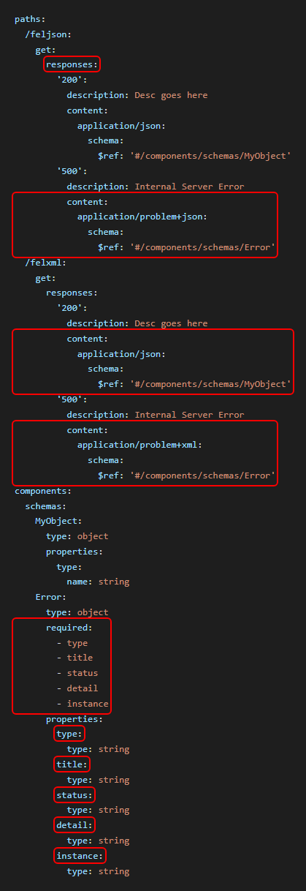

_Ovan exemplifieras regeln med en kontroll av den komplexa typen Error som beskrivs med media typen `application/problem+json`. Regeln kontrollerar förutom att typen återfinns att de ingående attributen `type`, `title`, `status`, `detail` samt `instance` återfinns._

---

### ID: FEL.02

**Krav:** Schemat enligt RFC 9457 bör innehålla de beskrivna attributen i FEL.01 och SKALL använda mediatypen `application/problem+json` eller `application/problem+xml` i svaret.

**Typ:** SKALL

**JSON Path Plus-uttryck:**

```
$.paths[*][*].responses[?(@property == 'default' || @property >= 400)].content
```

**Förklaring:**
Regeln förutsätter att den namngivna komplexa strukturen som återfinns under `components.schemas` innehåller de attribut som återfinns i kravet ovan.

**Exempel:**

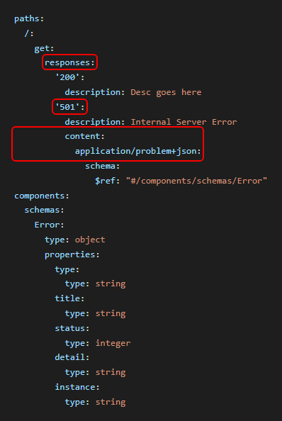

_Ovan exemplifieras regeln med en kontroll att den komplexa typen Error beskrivs med media typen `application/problem+json`. I detta fall så infaller regeln eftersom statuskoden för felet är 501 och faller inom ramen för kontroll. Regeln hade också infallit ifall media typen beskrivits med `application/problem+xml`._

---

## Område: Versionhantering

**Täckningsgrad: 10%**

### ID: VER.05

**Krav:** Version BÖR anges i URL enligt formatet v[x] där 'v' avser förkortning för version och x avser ett och bara ett nummer (0-n) för major-version.

**Typ:** BÖR

**JSON Path Plus-uttryck:**

```
$.servers.[url]
```

**Förklaring:**
Regeln förutsätter att den specificerade URL:en följer semantisk versionering enligt kravet. Regeln tillåter också att alpha/beta versioner specificeras.

**Exempel:**

![Exempelbild av en OpenAPI-specifikation där serverns URL under servers granskas för att kontrollera att API-versionen anges enligt formatet v[x], med ett enda nummer för huvudversionen.](images/ver5.png)

_Exemplet illustrerar hur regeln kontrollerar att versionsnumret i serverns URL följer det föreskrivna formatet v[x], där v anger version och x består av ett enda nummer som representerar API huvudversion. Regeln tillåter även alpha- och beta-versioner._

---

### ID: VER.06

**Krav:** Information om ett API SKALL tillgängliggöras via resursen `api-info` under roten till API:et.

**Typ:** SKALL

**JSON Path Plus-uttryck:**

```
$.paths
```

**Förklaring:**
Regeln förutsätter att resursen `api-info` finns tillgänglig under själva roten till API:et, där information om API:et skall tillgängliggöras.

**Exempel:**

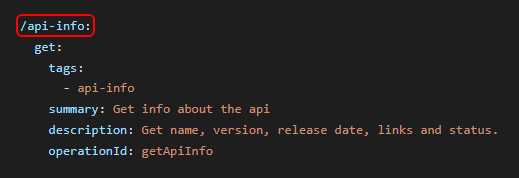

_Exemplet illustrerar hur regeln kontrollerar att resursen api-info finns definierad under paths på API rotnivå. Resursen ska tillgängliggöra information om API i enlighet med regelns krav._

---

## Område: Spårbarhet och korrelation

**Täckningsgrad: 43%**

### ID: SPA.02

**Krav:** API-producenter SKALL (SPA.02) acceptera HTTP-headern traceparent i inkommande anrop och propagera spårningsinformationen vidare enligt W3C Trace Context vid vidare anrop till andra system..

**Typ:** SKALL

**JSON Path Plus-uttryck:**

```
$.paths[*]
```

**Förklaring:**
Regeln kontrollerar varje dokumenterad GET-, PUT-, POST-, DELETE- och PATCH-operation under respektive path.

Kontrollen utgår från path-nivån för att kunna hantera att request-headern `traceparent` antingen definieras direkt på operationen eller ärvs från path-nivån.

`traceparent` ska vara definierad som en headerparameter med:

- `in: header`
- `name: traceparent`

`traceparent` får inte definieras med required: true. Om traceparent saknas i ett inkommande anrop ska API-producenten enligt SPA.03 generera en ny traceparent

Headern kan definieras direkt eller via `$ref` till `components.parameters`.

**Exempel:**

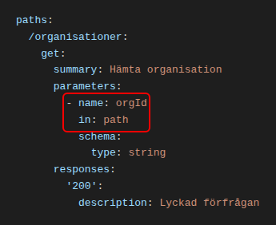

_I exemplet ovan saknas `traceparent` bland headers, vilket är ett brott mot regeln._

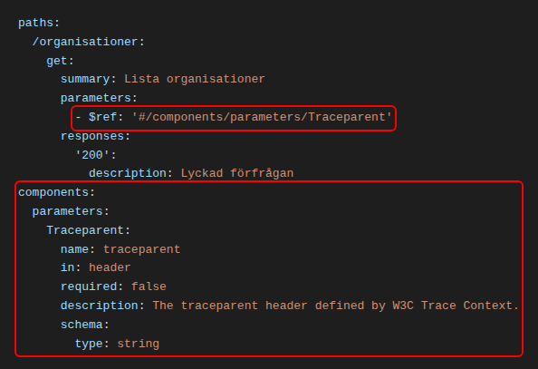

_I exemplet ovan definieras headern genom en `$ref` till `components.parameters`. Parametern har `required: false`, vilket innebär att `traceparent` inte är obligatorisk i det inkommande anropet._

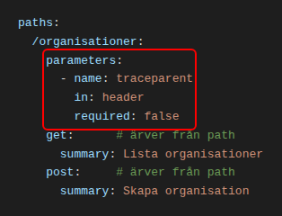

_Parametrar som är definierade på path-nivå gäller för samtliga operationer under samma path. I exemplet ovan ärver både `get` och `post` de headers som är definierade på path-nivå, och båda operationerna uppfyller därmed regeln._

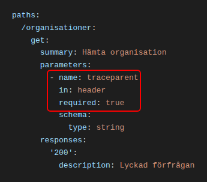

_I exemplet ovan är `traceparent` definierad med `required: true`, vilket är ett brott mot regeln. traceparent får inte vara obligatorisk eftersom API-producenten enligt SPA.03 ska kunna hantera inkommande anrop där headern saknas_

### ID: SPA.04

**Krav:** API-producenten BÖR (SPA.04) inkludera HTTP-headern traceparent i ett API-svar.

**Typ:** BÖR

**JSON Path Plus-uttryck:**

```
$.paths[*][get,put,post,delete,patch].responses[*]
```

**Förklaring:**
Regeln förutsätter att varje dokumenterat API-svar innehåller HTTP-headern `traceparent`. Headern kan definieras direkt under `headers` eller via `$ref` till en header som definierats under `components.headers`.

Regeln kontrollerar **endast** att headern är dokumenterad i OpenAPI-specifikationen. Den kontrollerar inte hur spårningsinformationen hanteras via körning, exempelvis att en ny spårkedja initeras enligt W3C Trace Context eller att samma `traceparent` returneras som i det inkommande anropet.

**Exempel:**

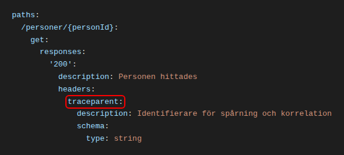

_I exemplet ovan kontrolleras att `traceparent` finns bland de headers som dokumenterats för API-svaret._

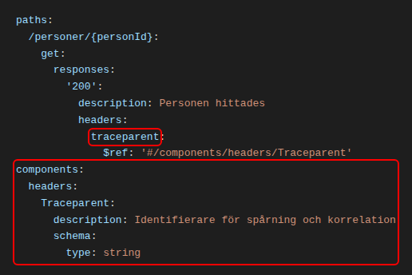

_Headern kan även definieras genom en `$ref` till `components.headers`._

---

### ID: SPA.07

**Krav:** Alternativa identifierare, såsom x-request-id, KAN användas som komplement för interna behov, men SKALL INTE ersätta traceparent vid spårning av API-anrop mellan system och organisationer.

**Typ:** SKALL INTE

**JSON Path Plus-uttryck:**

```
$.paths[*]
```

**Förklaring:**
Regeln förutsätter att om en HTTP-operation använder en alternativ identifierare för spårning, exempelvis `x-request-id`, så SKALL även `traceparent` vara definierad som request-header för samma operation.

Kontrollen utförs på operationens request-headers, det vill säga de parametrar som har `in: header`. Både parametrar som är definierade på path-nivå och parametrar som är definierade på operationsnivå ingår i kontrollen, eftersom parametrar på path-nivå gäller för samtliga operationer under samma path.

Headern kan vara definierad direkt på operationen eller på path, alternativt genom en `$ref` till `components.parameters`.

Regeln kontrollerar följande:

- Om request-headern `x-request-id` förekommer SKALL även request-headern `traceparent` förekomma.
- `traceparent` ska vara definierad med `in: header` och `name: traceparent`.
- `x-request-id` ska vara definierad med `in: header` och `name: x-request-id`.

Om en alternativ identifierare, exempelvis `x-request-id`, används utan att `traceparent` samtidigt är definierad är det ett brott mot regeln. En operation som varken använder en alternativ identifierare eller `traceparent` berörs inte av regeln.

Namnen på headers jämförs skiftlägesokänsligt eftersom HTTP-headers inte är skiftlägeskänsliga.

Regeln kontrollerar **endast** att headers är dokumenterade i OpenAPI-specifikationen. Den kontrollerar inte hur spårningsinformationen hanteras via körning.

**Exempel:**

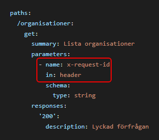

_I exemplet ovan används `x-request-id` utan att `traceparent` är definierad, vilket är ett brott mot regeln._

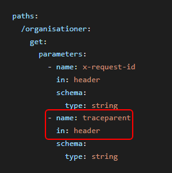

_I exemplet ovan används `x-request-id` som komplement till `traceparent`, vilket är tillåtet._

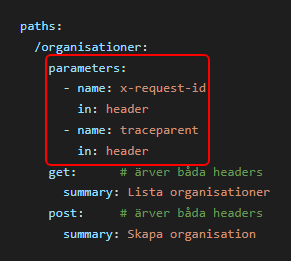

_Parametrar som är definierade på path-nivå gäller för samtliga operationer under samma path. I exemplet ovan ärver både `get` och `post` de två headers som är definierade på path-nivå, och båda operationerna uppfyller därmed regeln._

---

## Område: Filtrering, paginering och sökparametrar

**Täckningsgrad: 54%**

### ID: FNS.01

**Krav:** Parameternamn SKALL anges med en konsekvent namnkonvention inom ett API, exempelvis antingen snake_case eller camelCase.

**Typ:** SKALL

**JSON Path Plus-uttryck:**

```
$.paths.*.*.parameters[?(@.in=='query')].name
```

**Förklaring:**
Regeln förutsätter att definierade query parametrar som är satta för API:et följer en stringent namnkonvention som antingen är uppbyggd med snake_case eller camelCase.

**Exempel:**


_Ovan exemplifieras regeln med en kontroll av de parametrar som ingår under pathen /persons. I exemplet så kommer regeln att ge ett negativt utfall eftersom en av parametrarna (limt-this) är definerad med kebab-case och den andra parametern är definerad med namnkonventionen för camelCase._

**Exempel 2:**


_Ovan exemplifieras regeln med en kontroll av de parametrar som ingår under pathen /persons. I exemplet så kommer regeln att ge ett positivt utfall eftersom bådaparametrarna är definerade med giltiga namnkonventioner. Parametern limt_this är definerad med snake-case och den andra parametern pageThis är definerad med namnkonventionen för camelCase._

---

### ID: FNS.03

**Krav:** Sökparametrar SKALL starta med en bokstav.

**Typ:** SKALL

**JSON Path Plus-uttryck:**

```
$.paths.*.*.parameters[?(@.in=='query')].name
```

**Förklaring:**
Regeln förutsätter att definierade query parametrar som är satta för API:et startar med en bokstav.

**Exempel:**

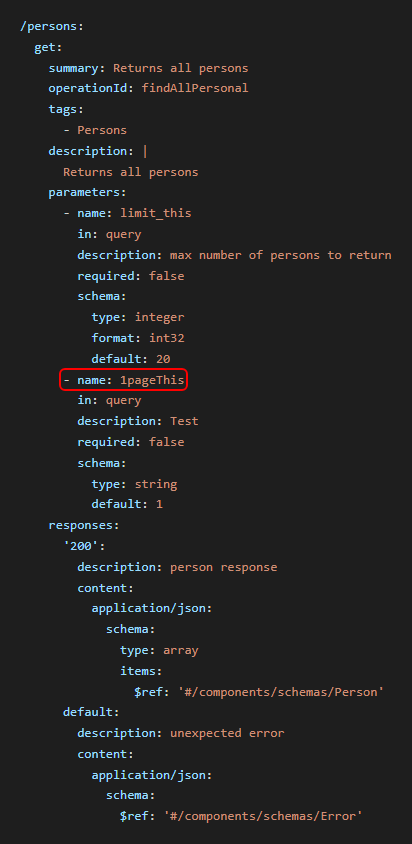

_Ovan exemplifieras regeln med en kontroll av de parametrar som ingår under pathen /persons. I exemplet så kommer regeln att ge ett negativt utfall eftersom en av de definierade parametrarna (1pageThis) ej startar med en bokstav._

---

### ID: FNS.05

**Krav:** Sökparametrar BÖR vara frivilliga..

**Typ:** BÖR

**JSON Path Plus-uttryck:**

```
$.paths.[*].parameters[?(@.in=='query')].required
```

**Förklaring:**
Regeln förutsätter att definierade query parametrar ej är satt som tvingande.

**Exempel:**


_Ovan exemplifieras regeln med en kontroll av de query parametrar som ingår under pathen /persons. I exemplet så kommer regeln att ge ett negativt utfall eftersom en av de definierade parametrarna (pageThis) är satt som tvingande._

---

### ID: FNS.06

**Krav:** Sökparametrar BÖR använda tecken som är URL-säkra (tecknen A-Z, a-z, 0-9, '-', '.', '\_' samt '~', se vidare i RFC 3986).

**Typ:** BÖR

**JSON Path Plus-uttryck:**

```
$.paths.[*].parameters[?(@.in=='query')].name
```

**Förklaring:**
Regeln förutsätter att definierade query parametrar har tecken som är definierade som URL-säkra

**Exempel:**

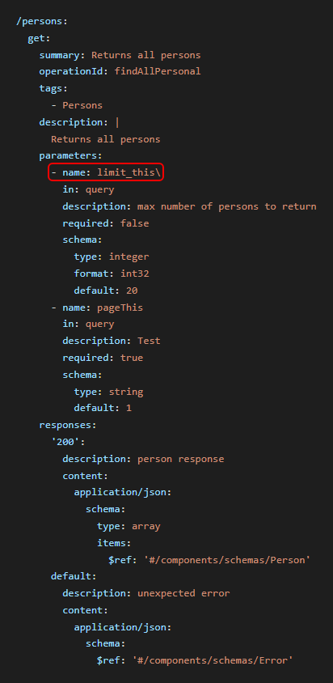

_Ovan exemplifieras regeln med en kontroll av de query parametrar som ingår under pathen /persons. I exemplet så kommer regeln att ge ett negativt utfall eftersom en av de definierade parametrarna (limitThis) innehåller tecken som ej är URL-säkra._

---

### ID: FNS.07

**Krav:** Vid användande av paginering, SKALL följande parametrar ingå i request: 'limit' och någon av 'page' eller 'offset'.

**Typ:** SKALL

**JSON Path Plus-uttryck:**

```
$.paths..parameters
```

**Förklaring:**
Regeln förutsätter att parametern 'limit' ingår om man använder sig av paginering. Användandet av paginering använder de reserverade parameternamnen page och offset.

**Exempel:**

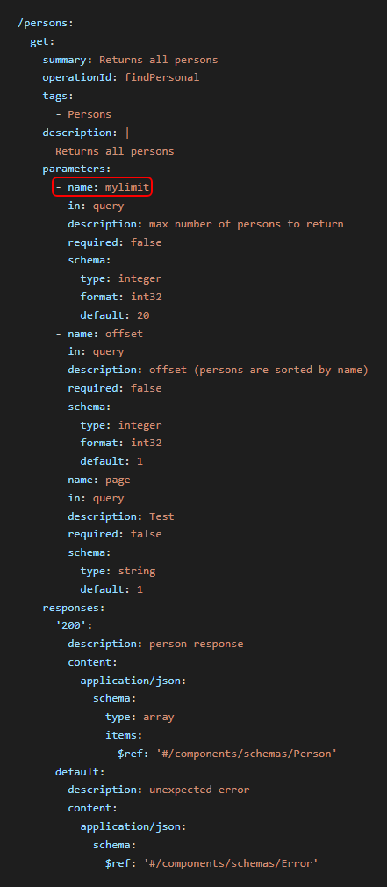

_Ovan exemplifieras regeln med en kontroll av de query parametrar som ingår under pathen /persons. I exemplet så kommer regeln att ge ett negativt utfall eftersom de reserverade parameternamnenorden 'page' och 'offset' ingår under pathen / persons, men inte det då tvingade reserverade parameternamnet 'limit'. I exemplet så finns det en definierad parameter (mylimit), men den är alltså inte giltig._

---

### ID: FNS.08

**Krav:** 'page' SKALL alltid starta med värde 1

**Typ:** SKALL

**JSON Path Plus-uttryck:**

```
$.paths..parameters
```

**Förklaring:**
Regeln förutsätter att ifall parametern 'page' ingår, så förväntas man använda sig av paginering. Regeln kontrollerar vidare att parametern 'page' har ett korrekt defaultvärde satt.

**Exempel:**


_Ovan exemplifieras regeln med en kontroll av de query parametrar som ingår under pathen /persons. I exemplet så kommer regeln att ge ett negativt utfall eftersom det reserverade parameternamnet 'page' ingår under pathen / persons, och har ett defaultvärde som är satt till 100 och ej till 1._

---

### ID: FNS.09

**Krav:** Defaultvärde för limit BÖR vara 20

**Typ:** BÖR

**JSON Path Plus-uttryck:**

```
$.paths..parameters
```

**Förklaring:**
Regeln förutsätter att ifall parametrarn 'page' eller 'offset' ingår, så förväntas man använda sig av paginering. Regeln kontrollerar vidare att parametern 'limit' ingår och har ett korrekt defaultvärde satt.

**Exempel:**


_Ovan exemplifieras regeln med en kontroll av de query parametrar som ingår under pathen /persons. I exemplet så kommer regeln att ge ett negativt utfall eftersom det reserverade parameternamnet 'page' ingår under pathen / persons, och att den reserverade parametern 'limit' ej har ett defaultvärde satt till 20._

---

## Område: Säkerhet

**Täckningsgrad: 19%**

### ID: SAK.01

**Krav:** All transport SKALL ske över HTTPS med minst TLS 1.2.

**Typ:** SKALL

**JSON Path Plus-uttryck:**

```
$.servers[*].url
```

**Förklaring:**
Regeln förutsätter att varje server har en giltig url specifierad och använder HTTPS-protokollet.

**Exempel:**


_Exemplet ovan är giltigt då samtliga servrar innehåller en giltig `url` och använder HTTPS._

---

### ID: SAK.09

**Krav:** Basic- eller Digest-autentisering SKALL INTE användas.

**Typ:** SKALL

**JSON Path Plus-uttryck:**

```
$.components.securitySchemes[*]
```

**Förklaring:**
Regeln förutsätter att inte Basic- eller Digest- autentisering är definierad i API:ets securityscheme.

**Exempel:**


_I exemplet ovan så kommer regeln att ge ett negativt utfall eftersom det finns både ett securityscheme definerad för basic och ett för digest._

---

### ID: SAK.10

**Krav:** Authorization: Bearer header SKALL användas för autentisering/auktorisation.

**Typ:** SKALL

**JSON Path Plus-uttryck:**

```
$..components.securitySchemes[?(@.scheme)]
```

**Förklaring:**
Regeln kontrollerar förutsatt att det finns ett securityscheme definierat, att autentisering och auktorissation sker via Bearer-token.

**Exempel:**


_I exemplet ovan så kommer regeln att ge ett positivt utfall eftersom det finns ett securityscheme definerad för bearer. Fältet 'bearerFormat' är valfritt och JWT anger att tokenen följer JWT-standarden_

### ID: SAK.11

**Krav:** En uppdateringstoken SKALL tillhandahållas för att förlänga giltighetstiden för befintliga token utan att behöva tillhandahålla referenserna igen.

**Typ:** SKALL

**JSON Path Plus-uttryck:**

```
'$.components.securitySchemes[?(@.type=="oauth2")]'
```

**Förklaring:**
Regeln förutsätter att API:et använder OAuth 2.0 för autentisering eller auktorisering.

För OAuth 2.0 SKALL minst ett flow av typen `authorizationCode`- eller `password` vara definierat. Det definierade flödet SKALL ha attributet refreshUrl definierat. Attributet används för att dokumentera den endpoint där en uppdateringstoken kan användas för att erhålla en ny åtkomsttoken utan att användaren behöver autentisera sig på nytt.

Regeln kontrollerar endast att refreshUrl är definierat i API-beskrivningen. Regeln kan inte kontrollera om uppdateringstoken faktiskt utfärdas eller om endpointen fungerar.

**Exempel:**


Bilden visar ett OAuth 2.0-security scheme med ett `authorizationCode`-flow. Flowet innehåller attributet `refreshUrl`, vilket innebär att kravet uppfylls.

---

### ID: SAK.15

**Krav:** API-nycklar SKALL INTE inkluderas i URL eller querysträngen.

**Typ:** SKALL

**JSON Path Plus-uttryck:**

```
$.components.securitySchemes[?(@ && @.type=='apiKey')]
```

**Förklaring:**
Regeln kontrollerar, under förutsättning att ett security scheme är definierat, att om typen är 'apiKey', så får värdet för parametern 'in' inte vara 'query.

**Exempel:**


_I exemplet ovan ger regeln ett negativt utfall, eftersom det definierade säkerhetsschemat 'ApiKeyQuery' har typen 'apiKey' och parametern 'in' är satt till 'query', vilket strider mot regeln._

---

### ID: SAK.16

**Krav:** API-nycklar SKALL inkluderas i HTTP-headern eftersom querysträngar kan sparas av klienten eller servern i okrypterat format av webbläsaren eller serverapplikationen.

**Typ:** SKALL

**JSON Path Plus-uttryck:**

```
$.components.securitySchemes[?(@ && @.type=='apiKey')]
```

**Förklaring:**
Regeln kontrollerar, under förutsättning att ett security scheme är definierat, att om typen är 'apiKey', så får värdet för parametern 'in' endast vara satt till 'header'.

**Exempel:**


_I exemplet ovan ger regeln ett positivt utfall, eftersom det definierade säkerhetsschemat 'ApiKeyQuery' har typen 'apiKey' och parametern 'in' är satt till 'header', vilket är i linje med regeln._

---

### ID: SAK.18

**Krav:** OAuth version 2.0 eller senare BÖR användas för auktorisation.

**Typ:** BÖR

**JSON Path Plus-uttryck:**

```
 $..[securitySchemes][?(@ && @.type=='oauth2' && @.flows ? true : false)][*].[?(@property && @property.match(/Url$/i))]
```

**Förklaring:**
Regeln kontrollerar, förutsatt att typen av säkerhetsschema är ett oauth2, att clientCredentials fälten tokenUrl och refreshUrl är specificerat med https.

**Exempel:**


_I exemplet ovan så kommer regeln att ge ett negativt utfall eftersom clientCredentials fälten tokenUrl samt refreshUrl är specificerat med http._

---

### ID: SAK.29

**Krav:** Man BÖR respektera angiven Content-Type i header. Förfrågningar som innehåller oväntade eller saknade Content-Type headers bör avvisas med HTTP-status 415 Unsupported Media Type.

**Typ:** BÖR

**JSON Path Plus-uttryck:**

```
$.paths[*][post,put,patch,delete,options]
```

**Förklaring:**
Regeln kontrollerar att HTTP-operationer som definierar en requestBody även dokumenterar ett svar för HTTP-statuskod 415 `Unsupported Media Type`.

Eftersom regeln validerar API-kontraktet och inte den faktiska implementationen kan den inte verifiera att API:et verkligen avvisar felaktiga eller saknade Content-Type-headers. Regeln säkerställer därför att detta beteende är dokumenterat i OpenAPI-specifikationen.

Om en operation innehåller en requestBody men saknar ett definierat 415-svar ger regeln ett negativt utfall.

**Exempel**


---

## Område: Förutsättningar

**Täckningsgrad: 100%**

### ID: FOR.02

**Krav:** EN GET -förfrågan SKALL INTE acceptera en body.

**Typ:** SKALL

**JSON Path Plus-uttryck:**

```
$.paths..get
```

**Förklaring:**
Regeln förutsätter att det inte finns en förekomst av element requestBody när en get operation används för att ställa en förfrågan av specifik resurs.

**Exempel:**


_I exemplet ovan så kommer regeln att ge ett negativt utfall eftersom GET operationer inte kan ha en requestBody definierad._
